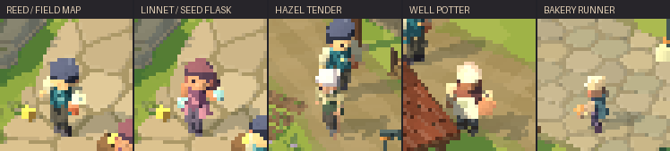

# 湖畔小屋 · 当前主角与角色试产记录

**F5 现在操控以《黄金太阳》Isaac 为直接参照的 3D 主角。** 金褐色发冠、额前几束尖刘海、蓝靛短上衣、浅色护领、橙色颈巾与高筒皮靴，都由实体几何构成。像素来自原地图的低分辨率正交视口，不是八方向贴图。当前是内部试玩造型，不是美术定稿。

[八角度：参考 GIF 首帧／480 实拍／320 实拍](previews/isaac-study/turnaround.png) · [走、跑：西南斜前方逐拍对照](previews/isaac-study/stride.png) · [主地图与小屋原画面、原地转面、待机拆帧](previews/isaac-study/in-play.png)

## 先在游戏里看

- 正常打开工程按 **F5**。无存档时沿出生石路走；有存档则留在原存档的位置。停住约 2.5 秒，接着能看到抬头与短眨眼。WASD／方向键走，Shift 跑。进湖畔小屋再出来，仍是同一外观；游戏窗里的 F5/F9 仍为原来的保存／读取。
- 看模型本身，可直接打开 [IsaacModel.tscn](../art/character_trial/isaac/IsaacModel.tscn)，在 3D 编辑器绕到背面看围巾的长短两端，选 `Motion` 预览 `idle`、`walk`、`run`。在游戏内想绕着**站着不动的人**看，可传 `--dev-camera`，再 Ctrl＋左键拖动。普通游玩不必打开开发镜头。
- 要复看上一版男主，不必改存档：`godot --path . -- --hero=reed`。`--hero=linnet` 为苇羽；`--legacy-cast` 让两个 Walker 恢复最早的 Courier 并关闭 CharacterTrial 旧试样组。也可在 Main 的 `CharacterTrial > Player Look` 选择三种主角。`--320`（放在 `--` 后）选择 320×180，默认 480×270。

## 从参考到 3D

只对 Isaac 的八方向**待机／走／跑**逐帧调查：24 个 GIF，合计 **116／48／48** 个时间样本。Pillow 按播放顺序合成局部更新与透明背景，保留整轮脚底的余量及原延时。正面待机首帧前景为 17×30 px，左侧 14×31，背面 17×29；两侧图像虽然互为镜像，3D 版本仍使用同一套非对称几何和同一盏场景太阳。

- **发型和体型。** 从前、侧、背的宽度和色块转折定标：收窄下颌，做略偏心的高发旋、向两鬓散开的棱脊和落在围巾前的后发。头皮外有 16 束有背面、厚度、转折和尖端的发束，不是单面发片。第一次试烘的午后发顶大面积过曝；按主地图实拍换成较暗的赭金底，只把浅麦色留在几道折光上。最终正面上方约 40% 的头部前景 RGB 中位数为 **187/133/57**，参考同区约 **181/115/57**：仍偏亮一些，不把它说成原色复现。
- **服装和动作。** 护肩、领圈、围巾两端、腰带、两层靴口与脚尖都有侧面和背面。15 根 `Skeleton3D` 骨驱动 16 个带顶点色的实体网格部件，使用场景照明、投影、深度遮挡；无 Sprite3D、billboard、图集或外置角色贴图。待机稳脚、抬头、短闭眼；走、跑各有六个真正的 3D 关键姿，跑在触地时压低髋部，收后腿、加前倾和对侧摆臂，不是把走路快放。参考正向六拍为 6×100 ms，斜侧多为 6×150 ms；3D 版不随观察角换速度，满幅走／跑循环分别为 **0.72／0.60 s**，按 Walker 真实位移推进，保留原有 2.45／4.10 m/s 步速。
- 资产可以独立编辑：[几何源](../source/isaac_study/sculpt.gd) · [骨骼动作及原生场景烘焙](../source/isaac_study/bake_model.gd) · [Walker 外观适配](../art/character_trial/isaac/isaac_look.gd)。烘焙产物不依赖参考文件；玩法、碰撞、房间 ID、存档格式不由该模型负责。

## 实测和边界

Windows、Godot 4.7.2、GL Compatibility、RTX 4090。[原场景窗口回归](../tests/isaac_hero_checks.gd) 在 **480×270、320×180 均 112/112**：不传外观参数启动，按实际输入切八向，取走／跑六拍；保持角色世界朝向，单独转动相机 0°／90°／180°；走过真实门槛、进屋保存、出门、F9 回到原室内位置；切回岚和苇羽再恢复。单独以 `--hero=reed`（480）和 `--hero=linnet`（320）启动旧试样，各 **44/44**；Courier 回退 **2/2**。另用默认 3D 主角跑现有 `play_checks / door-write` 和 `door-read`：两档均 **0 failures**，每次写档后启动新游戏进程，复核离开入口后的室内坐标和已拿物品。均用独立测试槽。

| 默认室外镜头 | 正面 | 左侧 | 正背 | 出生点斜前 |
| --- | --- | --- | --- | --- |
| 参考首帧 | 17×30 | 14×31 | 17×29 | 16×31 |
| 480 实拍的可见模型 | 16×31 | 14×32 | 16×29 | 15×31 |
| 320 实拍的可见模型 | 11×20 | 9×22 | 11×19 | 11×20 |

八向待机中，480 档可见头部（含发尖）约占整身高 **45%–52%**。用真实网格的深度测试遮罩与 GIF 透明轮廓比较：裁到前景，允许 X/Y 各 ±4 像素平移，不缩放、不旋转；取交集／并集的均值，八向待机 **0.792**，斜前六拍走 **0.760**、跑 **0.736**。这些数只量外轮廓，不是“还原度评分”。斜前跑的伸臂与远靴仍不逐点重合。320 实拍的短眨眼与前一持姿相比，在 67 个可见头部像素里只有 2 个的任一 RGB 通道变化达 24/255；小档尤其需要实际试玩判断读形。3D 侧光也不会反转成 GIF 的镜像高光。走跑对照图中的参考／480 画格放大 3 倍，320 画格放大 5 倍，均非对原画做非等比拉伸。

**未做模型目视通过判定。** 对原 GIF、拆帧接触表和最终 PNG 均尝试了受支持的读图工具，本次远程执行器返回 `Remote image reads are not supported`；桌面查看源不能代读这个远端目录。上面是逐像素统计、几何检查和真实视口证据，不是 Astra 对画面的主观目视背书。请用三张对照图或实际 F5 转面判断造型是否满意。

**权利边界：仅供内部试玩。** 运行时不引用原 GIF，本轮也没有复制或分发原文件；带参考帧的对照页在 `.gdignore` 目录，仅供内部评审。手动打包时也应排除本地 `ref/`。重建 3D 网格不等于取得 Isaac 角色设计或原图授权。对外发包、宣传截图或发布文档前应确认相应权利，未确认就替换角色并移除含参考图的评审页。

复跑示例（实际窗口，输出须是新的绝对目录）：

```text
godot --path . --disable-vsync --fixed-fps 60 --resolution 480x270 --script res://tests/isaac_hero_checks.gd -- --output=C:/Temp/isaac480
godot --path . --disable-vsync --fixed-fps 60 --resolution 320x180 --script res://tests/isaac_hero_checks.gd -- --320 --output=C:/Temp/isaac320
python source/isaac_study/compare_frames.py --wide C:/Temp/isaac480 --small C:/Temp/isaac320 --out C:/Temp/isaac-comparison
```

---

## 历史留档：第一轮原创角色试产

以下为岚、苇羽和三位村民的**上一轮记录**。其中「默认岚」「村民没有碰撞」「CopperLoft 旧断言」描述的是当时版本，不是现在的 F5 状态。现行居民／魔物碰撞见[户外实体占位](field-occupancy.md)，房屋接线见[室内文档](interiors.md)。



## 从新参考读到了什么

Windows 上用已有 Pillow 11.2.1 顺序解码并合成 GIF 帧，保留原画布、透明边距、脚底位置和逐帧时长；另用 ffprobe 复核 `Isaac_Walk` 的六个 100 ms 帧。共分析 **Isaac 25 / Jenna 10 / Young Jenna 7 / Villager 22** 个 GIF。用 alpha ≥ 128 的最大八连通前景比较包围盒、行宽、重心和底部像素；另生成过原画布对齐的临时接触表。远端 GIF 和 PNG 均无法回显，官方桌面源不适用于此远程工作区；下文是像素量测与从轮廓推得的设计判断，不是对参考图的人工目视鉴定。头部范围按外轮廓及明度块转折粗分，非解剖标注。

| 参考 | 样本证据 | 用到试产里的规则 |
| --- | --- | --- |
| **Isaac，男主方向** | 正向首帧 **17×30 px**，斜前常见 **15–16×31–32**，侧向 **14–16×31**。侧向从头顶到脸颈转换约 **14–16 行**，约半身高；上部饱满，腿脚收窄，斜视下近脚与远脚能分成前后。正向待机脚底始终在同一行，重心 X 仅约 8.1–8.5 px。 | 做紧凑大头、清楚的前后脚，不把待机做成全身蹦跳；用一块可从侧面认出的发顶和斜向胸线，不取用参考发型／配色。 |
| **Jenna，女主方向** | 正向 **20×28**，上／中／下三段最大外宽为 **14/18/20 px**；斜前约 **15–16×28–29**。脸颈附近约 **12–14 行**，仍接近半身高。侧向上部后方有延伸轮廓；移动采样中走 **14×28**，跑 **14–17×28–29**。 | 不是换色的男体：缩短整体，用偏侧的低辫与错落衣摆分辨正、侧、背，跑时发尾有延迟，脸与大衣褶仍是整块。Young Jenna 的更小体量只作年龄差参考。 |
| **走／跑和招牌姿态** | 主角走、跑样本每循环六帧。Isaac 正向走与跑均为 6×100 ms，多数其他方向为 6×150 ms；Jenna 两个移动 GIF 都为 6×150 ms。**不能仅凭延时断言跑更快。** Isaac 侧走外宽 17 px，侧跑 15–20，底部两行的足部宽度变化更大；Jenna 从走的恒定 14 px 到跑的 14–17 px。`TossCoin` 是 **1000 + 4×100 + 350 ms**，脚底不变、外宽从 17 扩到 20，先停、动作展开、再给辨认时间。 | 六个重音组织步态，走以交替支撑为主；跑增加前倾、摆臂、迈幅和腾空，**不靠单纯快放**。招牌姿态是原创的展开折页或举瓶，稳脚、预备、保持、收势。 |
| **Villager，体型与职业种子** | 22 个首帧最大体宽 **14–22 px**、总高 **22–31 px**。`Villager21` 约 **15×22**，`-8` **14×24**；`-4` **18×28** 且中段宽于上段；`-14` **17×28**，底部一侧有细长延伸；`-9` **20×25** 且上段比中段宽；`-13` **22×29**。待机常有长停帧和 100 ms 短变换。 | 年龄、职业和重心组合，不把文件名当作职业鉴定。一个弓身且竖杖的老人、一个横宽持陶器的成年工人、一个矮轻抱面包的少年，先在无色剪影里分得开。 |

## 原创试样与像素尺度

- **岚 Reed（男主，堤岸测绘员）**：墨蓝横扫发顶、宽肩、湖蓝对角折领、砖褐图筒和分岔短外衣。站稳后抬两肘展一张浅色折图。
- **苇羽 Linnet（女主，温室采种客）**：偏侧低辫、梅色前后错落衣摆、浅青种袋和暖陶袖。举种瓶时把胳膊打开到肩外，给 320 档留下能读到的透景空间。
- **榛篱老人／井边陶工／面包跑堂**：矮窄前倾配灰鬓与桦杖；厚肩宽腰配浅麻围裙和陶壶；小身量配方软帽、带布包的面包和一段走出跑回的短路线。不是同一身体换色；都只有呈现，没有交互、伤害或存档身份。
- **先轮廓，再色块，再细节。** 试样沿用原正交镜头、3D 深度遮挡、投影和地图照明，用大块顶面／侧面表现体积，不加屏幕描边或密集花纹。实际默认斜俯视的主角头顶至下颌可见高度约占整体 **38–42%**（不把垂辫算进头），比 GIF 的粗分略克制，留给两档镜头下的手势、腿脚和道具。320 以约 20–24 px 的主角身体仍能留出辨识块为准，不放大镜头来掩盖问题。
- [几何与色板](../art/character_trial/cast_geometry.gd)为原创实体截面，[动作](../art/character_trial/cast_rig.gd)用真实 XZ 位移推进脚相位，用短支撑、屈膝、前倾与配件滞后区分跑。原步速 **2.45 / 4.10 m/s** 没改；岚在稳速下的走／跑循环约 **0.60 / 0.52 s**。默认人在原地约四秒后才做招牌动作，起步即中断，不夺取控制。

## 在原地图看

1. 打开工程，**编辑器 F5** 仍运行 `Main.tscn`。默认操控岚；无存档时在原出生石路，苇羽在画面右下方路肩（约 `XZ 1.09, 7.36`）。站定看动作，WASD／方向键走，Shift 跑，滚轮保持原功能。默认档就是 480×270 的原生 `Pixels`，不是把显示窗口硬裁为 480×270。
2. 要操控苇羽，可在 Main 的 `CharacterTrial` 节点把 `Player Look` 切到 **Linnet**，或从工程目录运行 `godot --path . -- --hero=linnet`，后者不修改工程或存档。需要 320×180 时在 `--` 后加 `--320`；也可用 `--resolution 320x180` 使外窗为 1:1。另一位主角自动留在原路肩，原小屋内的同一玩家沿用所选外观。
3. **背向小屋沿原石路和车辙去井边村**：到菜地外侧看榛篱老人（`8.43, 23.38`），过井沿车辙向铁匠屋方向看陶工（`16.74, 26.86`）。接着走过林间兽径进石街镇；到面包铺前靠长凳一侧，约 `XZ 31.08–33.22, 75.6`，等面包跑堂走一趟、停一会，再跑回来。三人不挡路。原存档若从别处开始，只需沿同一地图走来，不要清除存档。
4. 回退：传 `--legacy-cast` 或取消 `CharacterTrial.Enabled`，两个活动玩家节点马上使用原 Courier，三名村民和另一主角不生成。只增了 [Main](../Main.tscn) 的 [摆场节点](../art/character_trial/cast_director.gd) 和 [Walker](../scripts/walker.gd) 的可选呈现回调；没有改原角色资产、各舱/地区的存档键、地形或相机。运行中游戏窗的 F5/F9 仍是原保存／读取，外观不写盘。

## 实际渲染、验证与未定项

实拍为 **Windows / Godot 4.7.2 / GL Compatibility / RTX 4090** 上的主场景 `Pixels`，默认正交跟随镜头，不使用近景试装台。合图不缩放格子；只在上面的局部详情作 4 倍最近邻放大。

- **主角**：[480×270](previews/character-trial/heroes-480.png) · [320×180](previews/character-trial/heroes-320.png)。上排岚、下排苇羽，每排左到右为待机、走、跑、招牌姿态。待机格可同时对照另一位主角。
- **村民**：[480×270](previews/character-trial/villagers-480.png) · [320×180](previews/character-trial/villagers-320.png)。上排为榛篱老人、晴天陶工、同站位薄暮陶工；下排为跑堂站定、走出、跑回。较早的井位与镇口外端分别会被棚屋／树前景遮没，改摆到上述路肩；陶工的浅麻围裙也经过薄暮对照，没有加试样专用灯。
- [窗口测试](../tests/character_trial_checks.gd)：岚＋出生点至面包铺主路两档各 **95/95**，苇羽启动选项与动作两档各 **44/44**，旧外观开关 **2/2**。由脚本注入实际镜头相对输入，经 Walker 碰撞通行，检查八方向、Sprint、原 F5/F9 位置、室内外外观和存档。`play_checks` 的 `door-write`、`door-read`、`regions`、`table-menu` 和并行室内分支的七门 [门槛回归](../tests/interior_door_checks.gd) 在两档均 **0 失败**，未使用玩家槽或改键文件。
- 旧 [连续路线回归](../tests/clearing_route_checks.gd) 在 480 档走完约 95 m 外出路，但折返前仍把已接入室内的 CopperLoft 当封闭外壳断言；新装与 `--legacy-cast` 同样 **19/22**，因此不能算旧整条折返回归通过。角色试产不改该断言或室内接线。
- **读形证据：** 320 档主角待机为岚 **11×24**、苇羽 **12×22** 可见像素包围盒；老人 **8×20**，陶工 **14×21**，跑堂 **10×16** 待机。两档合计，英雄待机到招牌姿态脚底对齐后的剪影并集变化 **14.4–18.6%**，走到跑 **23.9–34.4%**。薄暮陶工最差一档仍有 **67.6%** 可见轮廓像素与同站位隐藏人物的背景在任一 sRGB 通道相差 ≥ 0.09。只证明这些帧的大小、变形、分色和遮挡；不是对连续画面的人工验收。
- **留待试玩决定：** 320 时是否还要再放大发型和手持物；同一批五人加入更密集市街后是否会互相抢眼；夜间、全方向连续动作、坡面脚底与镜中细节需继续目视检查。服装方案和名字是试产项；此轮不做正式选角界面、居民日程、对话、战斗或新增室内接线。

复跑示例（输出目录必须尚不存在，截图来自现有场景而非独立 Demo）：

```text
 godot --path . --disable-vsync --fixed-fps 60 --resolution 480x270 --script res://tests/character_trial_checks.gd -- --full-route --output=C:/Temp/cast480
 godot --path . --disable-vsync --fixed-fps 60 --resolution 320x180 --script res://tests/character_trial_checks.gd -- --320 --hero=linnet --output=C:/Temp/linnet320
 godot --headless --path . --script res://tests/character_trial_checks.gd -- --legacy-cast
```
